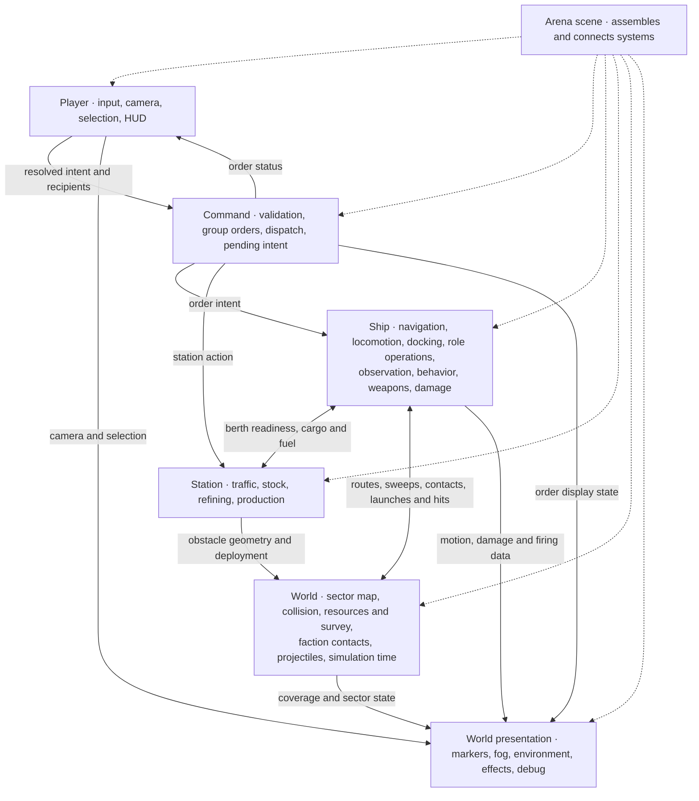

# Apalit architecture

## Current architecture

Snapshot of `main` at `8a0095e` (`Extract reusable Command layer from arenas`). The Player and Command migrations are implemented and accepted. `project.godot` starts [Combat Test](game/scenes/combat_test.tscn). The [Test Arena](main.tscn) exercises the economy, [Movement Test](game/scenes/movement_test.tscn) exercises movement, and the encounter fixtures exercise combat. Each uses the shared Player scene and a Command node backed by the same script.

### Systems and dependencies

| System | Owns | Key dependencies |
| --- | --- | --- |
| Arena · [`movement_lab.gd`](game/scenes/movement_lab.gd) | Scene setup, world queries, ship registration, autonomous movement, and group destination queries for combat orders | Configures Player and Command, binds scripted MOVE from CombatOrders to Command, and connects Shipyard deployment and Combat destruction and removal to Player registration. On destruction it tells Command to discard the ship's pending entry. |
| Player · [`game/player/`](game/player) | Screen input, camera rig, selection and picking, targeting mode, HUD and inspectors, hover, cursor, notices, and movement indicator | The shared scene supplies the camera, selection, notice, and movement indicator. Arenas add their applicable panels and HUD. Player resolves input into an intent with explicit recipients, calls Command for submission, availability, and held MOVE destinations, and routes TARGET and other combat actions through CombatOrders. It reads visibility through the arena. Strategic View supplies strategic picks and manages camera handoff. |
| Command · [`command.gd`](game/command/command.gd) | MOVE, group MOVE, DOCK, and MINE validation, preview, dispatch, partial acceptance, and held-order replay | The arena supplies GroupOrders, StaticNavigation, the optional asteroid field, and the sector size query. Command tracks pending intent and emits `command_given` to ShipBehavior when an order is dispatched. Docking retains the callback and controls when it runs. Submission returns a boolean that includes queued and held orders. |
| Group and combat orders · [`group_orders.gd`](game/orders/group_orders.gd), [`combat_orders.gd`](game/combat/combat_orders.gd) | Group destination assignment and combat order entry points | GroupOrders checks ship footprints and StaticNavigation. CombatOrders delegates scripted MOVE to Command. Scripted single-ship MOVE uses the held-order path, while scripted group MOVE dispatches directly through GroupOrders. Player group MOVE can hold individual destinations during station control. Attack-Move and Waypoint still use the arena's group destination query. |
| Ships · [`game/ships/`](game/ships) and role components | Per-ship movement, docking, fuel, cargo, mining or transport, scanner, behavior, weapons, and damage state | Archetypes assemble shared scripts. Miner, Transporter, and FF-01 variants supply tuning and hull geometry. RouteFollower queries StaticNavigation. Avoidance reads route intent and nearby ships. Locomotion asks PlanarCollision before committing movement. Fuel reads committed displacement. ShipBehavior uses arena movement and faction contacts. |
| Stations · [`game/stations/`](game/stations), [`game/refining/`](game/refining), [`game/shipyard/`](game/shipyard) | Berths, queues, holds, exit clearance, storage, fuel stock, refining, and construction | Docking coordinates reservation and guided motion with Station and Berth, and transfers through the shared Inventory implementation. Refinery and Shipyard consume station stock. Shipyard deploys a ship variant into `Ships` and emits `ship_deployed`. |
| Survey and resources · [`game/survey/`](game/survey), [`game/resources/`](game/resources) | Asteroid deposits and reserves, fleet survey knowledge and scan progress | A ship's Scanner requests a survey. Extractor debits AsteroidField reserves and fills Cargo. SurveyView and hover read survey state. |
| Sector and combat services · [`game/navigation/`](game/navigation), [`game/collision/`](game/collision), [`game/sensors/`](game/sensors), [`game/combat/`](game/combat), [`game/time/`](game/time) | Static route maps, planar sweeps, faction detection, projectile and ordnance simulation, and simulation time | Navigation and collision read scene geometry and station obstacle meshes at startup. Sensors read ships and asteroid occluders and update faction contacts. Weapons launch through ProjectileSystem, which tests impacts and sends hit data to CombatShip. SimClock supplies timestamps, and TimeControl manages pause and time scale. |
| World presentation · [`game/presentation/`](game/presentation), [`game/debug/`](game/debug) | Tactical and strategic views, fog, highlights, effects, environment, and diagnostics | Reads Player camera and selection, survey and contact state, routes, ship motion, and combat data. Combat effects and trails consume firing, impact, and flight data. Reusable UI controls and theme live in [`game/ui/`](game/ui). |

The main remaining coupling is in scene wiring. Ship and station components still use relative `NodePath`s to reach arena services. Execution order is also a dependency. Sensors update before Behavior, RouteFollower runs before Avoidance at the same physics priority, and Fuel reads the displacement Locomotion committed that tick. Scene composition and order matter alongside the script interfaces.

## Target architecture

The diagram describes the proposed destination for the remaining migration. The reusable Player scene and the resolved-order Command component are in place. An arena assembles the layers and supplies their references.

### Systems and dependencies



| System | Boundary |
| --- | --- |
| Player | Owns how the player picks and acts. Sends resolved targets and a snapshot of the intended recipients. Reads order and entity status for display. Camera and HUD changes can stay inside Player. |
| Command | Owns the submission interface, validation, group dispatch, and the lifecycle of pending intent. Reports whether an order started, was held, or was refused. Ship and Station supply execution readiness. The same interface can serve a player, fixture, or scripted controller. |
| Ship | Owns execution and per-instance state. Route following and avoidance supply steering intent. Locomotion commits movement. The ship contributes an observation source to faction detection. Weapons manage firing and supply hit data, while damage owns its effect on the ship. Hull definitions and variant resources remain reusable. |
| Station | Owns traffic, inventory, and production. Ship Docking requests a berth or an exit, and the station supplies clearance and guidance geometry. Station stock and ship cargo retain their respective owners. |
| World | Supplies sector-wide queries and simulation services. Routes and sweeps inform ship movement. Faction contacts combine ship observations. Projectile simulation resolves impacts and delivers hit data to ships. |
| Presentation | Reads state from the system that owns it. For example, order markers read pending order state, fog reads faction coverage, and thrusters read committed ship motion. Player HUD and inspector scenes remain in Player. |

#### Temporary arena wiring

| Current connection | Removal condition |
| --- | --- |
| Arena forwarding for ship startup, deployment, destruction, and removal | Ship and World expose equivalent lifecycle notifications, including registration in the same call as deployment. |
| Arena queries for visibility and sector state | World exposes equivalent queries and their consumers migrate. |
| Arena `autonomous_move()` for ShipBehavior and `group_destinations()` for CombatOrders | The owning systems expose equivalent movement and group assignment interfaces, and ShipBehavior and CombatOrders use them. |

### Folder structure

Proposed organization by ownership. `game/player/`, `game/command/`, `game/ui/`, `game/presentation/`, and `game/tests/` already exist. GroupOrders remains in `game/orders/` and CombatOrders remains in `game/combat/`. Keep scene and resource references valid during each migration, including inherited scene overrides and `.uid` files.

```text
architecture.md
project.godot
main.tscn                     # Test Arena entry scene
assets/                       # Source art
experiments/                  # Isolated prototypes and evaluations
game/
  scenes/                     # Playable arena composition and wiring
  player/
    player.gd
    player.tscn
    camera/
    selection/
    movement_indicator/
    ui/                       # Player HUD, inspectors, hover, cursor and notices
  command/
    command.gd                # Resolved order validation, dispatch and held intent
  ships/
    archetypes/               # Reusable role composition
    components/               # Navigation, locomotion, avoidance, docking,
                              # cargo, fuel, role operations, behavior and damage
    weapons/                  # Reusable mounts, weapon scripts and configurations
                              # Ship variants and hull scenes live under ships/
  stations/                   # Layouts, berths, traffic and storage
    refining/
    shipyard/
  world/
    navigation/               # Sector map and static route queries
    collision/                # Planar sweeps and occupancy
    resources/                # Asteroid field and shared inventory rules
    survey/                   # Fleet knowledge and scan progress
    sensors/                  # Faction detection and contact memory
    projectiles/              # Round and ordnance simulation
    time/                     # Simulation clock and time controls
  presentation/               # World views, fog, environment and effects
  debug/                      # Development overlays
  ui/                         # Reusable theme and controls
  tests/                      # Standalone suites and integration fixtures
```

Group coordination covers the existing group-order behavior. Persistent formations would require a separate design decision.
